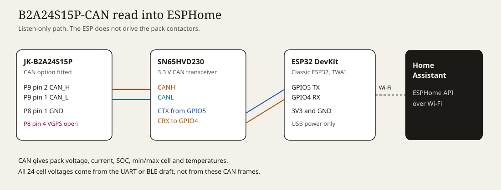
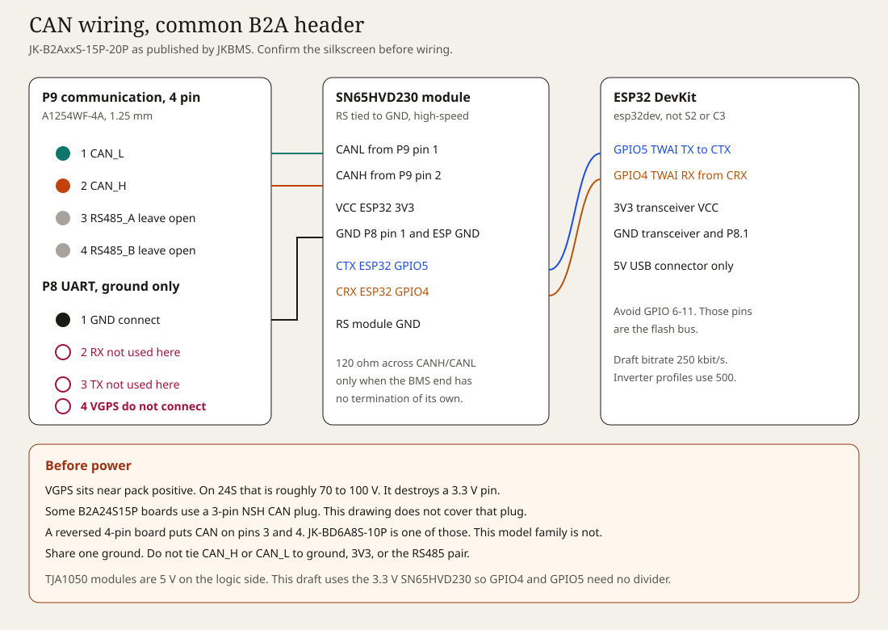
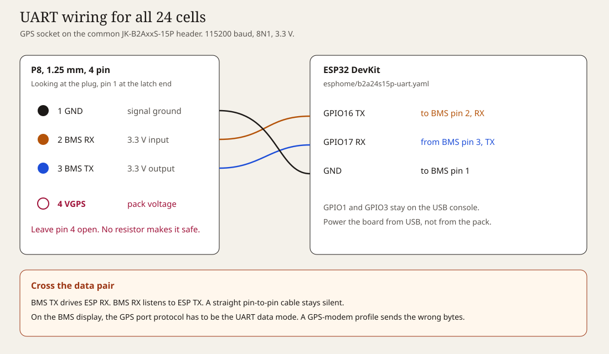

# ESPHome-JK-BMS

Draft configurations for a JK-B2A24S15P with the CAN option, and one ESP32 running ESPHome. Nothing here has been flashed on that hardware.

The CAN port publishes a summary. Pack voltage, current, state of charge, the highest and lowest cell, and temperatures. The 24 separate cell voltages come from the UART socket or from Bluetooth.

| Draft | What it reads | Bus |
| --- | --- | --- |
| `esphome/b2a24s15p-can.yaml` | Instrument frames `0x02F4`, `0x04F4`, `0x05F4`, `0x07F4` | CAN 2.0A, 250 kbit/s. Positive current is discharge. |
| `esphome/b2a24s15p-can-pylon.yaml` | Inverter broadcast `0x351`, `0x355`, `0x356` | CAN, 500 kbit/s. Positive current is charge. |
| `esphome/b2a24s15p-uart.yaml` | All 24 cells, pack values, temperatures | GPS/UART, 115200 8N1 |
| `esphome/b2a24s15p-ble.yaml` | Same measurements as UART, no cable | Bluetooth, `JK02_24S` |

Copy `esphome/secrets.yaml.example` to `esphome/secrets.yaml` before compiling. Flash from the `esphome` directory.

```bash
esphome run esphome/b2a24s15p-can.yaml
```

On the first CAN boot, watch the log. IDs `0x02F4` belong to the instrument draft. IDs `0x351` and `0x356` belong to the Pylon draft. Any other ID means the profile in the BMS is neither of these maps.

## Wiring







P9 on the JK-B2AxxS-15P family, as published by JKBMS for that header:

| Pin | Signal | ESP side |
| --- | --- | --- |
| 1 | CAN_L | SN65HVD230 CANL |
| 2 | CAN_H | SN65HVD230 CANH |
| 3 | RS485_A | leave open |
| 4 | RS485_B | leave open |

P8, used for ground and for the UART draft:

| Pin | Signal | ESP side |
| --- | --- | --- |
| 1 | GND | ESP32 GND and transceiver GND |
| 2 | BMS RX, 3.3 V | GPIO16 TX, UART draft only |
| 3 | BMS TX, 3.3 V | GPIO17 RX, UART draft only |
| 4 | VGPS, near pack positive | do not connect |

VGPS on a 24S pack is about 70 to 100 V. It must not touch the ESP32 or the transceiver.

Some B2A24S15P units ship a 3-pin NSH CAN plug instead of this 4-pin header. The signal order of that plug is not in the table above. A few other JK boards reverse the 4-pin header so CAN sits on pins 3 and 4. Match the silkscreen on the board in front of you.

The transceiver in the figures is an SN65HVD230, powered from the ESP32 3V3 pin. GPIO5 is TWAI TX and goes to CTX. GPIO4 is TWAI RX and comes from CRX. Tie the module RS pin to GND.

## Test case

`tests/test_jk_can.py` checks the decoders against the worked examples in the BMS-CAN protocol and against one published Pylon-style frame.

```bash
python3 -m unittest discover -s tests -v
```

Two examples in section 7 of that PDF do not agree with their own bytes. The discharge-time field printed as `64 40` is not 100 h, and the cell-voltage test pastes a status payload onto ID `0x04F4`. The test uses the section 6 frames, whose bytes match the stated volts, amps, and cell numbers.

## Sources

- JKBMS, CAN and RS485 pinout for the JK-B2AxxS-15P family: https://www.jkbms.net/solutions/inverter-bms-communication
- BMS-CAN communication protocol, CAN 2.0A at 250 kbit/s: https://github.com/syssi/esphome-jk-bms/blob/main/docs/BMS-CAN%20Communication%20protocol.pdf
- UART and BLE component used by the wired and Bluetooth drafts: https://github.com/syssi/esphome-jk-bms
- ESPHome CAN bus: https://esphome.io/components/canbus/
